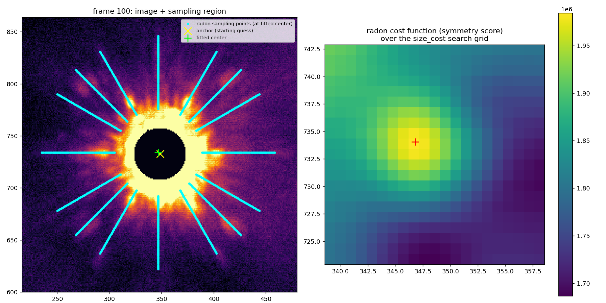

.. _radon-centering-label:

Radon-Transform Centering
==========================

When a target is saturated, coronagraphic, or otherwise has a core that is too non-Gaussian
for a simple 2-D Gaussian/Moffat fit (see :py:func:`pyklip.fakes.gaussfit2d`), pyKLIP provides
an alternative centering routine based on the Radon transform in
:py:mod:`pyklip.instruments.utils.radonCenter`. This page walks through how it works, which
parameters matter, why masking the core is critical to getting a good fit, and how to visually
debug a fit that doesn't look right.

How It Works
------------
The core idea, from `Pueyo et al. (2015) <https://ui.adsabs.harvard.edu/abs/2015ApJ...803...31P/abstract>`_,
is that a broadband image of the speckle/diffraction halo of the star's PSF points back to the 
star's position: all diffraction features are radially extended so at the true star location, all
speckles would point back towards the star. :py:func:`~pyklip.instruments.utils.radonCenter.searchCenter` samples the
image along a set of lines at angles ``theta``, radiating out from a set of candidate center
positions on a grid around your starting guess, and scores each candidate by how much flux
is traced by those lines (the true center maximizes the integrated flux along the lines). The 
radon transform is a straightforward way to compute the flux along those lines. The algorithm further
refines the center to sub-pixel precision by interpolating the 2-D score map. 
This makes it well-suited to saturated cores, coronagraphic images, and other
cases where the core itself has no clean, fittable Gaussian-like peak. 

Basic Usage
-----------
The simplest call just needs the image, a starting guess, and a size for the search:

.. code-block:: python

    from pyklip.instruments.utils.radonCenter import searchCenter

    # x_guess, y_guess: starting guess for the center (pixels)
    # size_window: roughly half the image size, or the largest annulus radius you want to consider
    x_cen, y_cen = searchCenter(image, x_guess, y_guess, size_window=image.shape[0] / 2,
                                 m=0.2, M=0.8, size_cost=7, theta=[45, 135])

For a worked example wired into an instrument module, see
:py:func:`pyklip.instruments.NIRC2.get_star`, which wraps ``searchCenter`` with diffraction-spike
and stellar-halo masking built in and is a good reference for how to combine masking with the fit
(see `Masking the Core`_ below).

Key Parameters
--------------
* ``theta``: The angles (degrees) of the lines summed by the Radon transform. More angles allow you
  to trace out more speckles of diffraction spikes. It is important to pick enough to trace out the
  main PSF features you want to use. Two angles (e.g. the default ``[45, 135]``) is good for a PSF
  with two main diffraction spikes. It can take some iteration to get the right angles for your PSF
  (see `Debugging with Visualization`_).
* ``m``, ``M``: Fractions that set where along each line the sampling happens. The sampled
  annulus is ``(m * eff_window, M * eff_window)`` on both sides of the candidate center, where
  ``eff_window`` is the *effective* window described below. Use ``m`` to exclude the saturated/
  masked core and ``M`` to stay within the frame. Useful to ignore the central region (not pointed back to the center)
  and far out (too faint to be useful; also there are interpolation errors if we sample beyond the image bounds). 
  Somewhat degnerate with ``size_window`` below.
* ``size_window``: Nominally "the radius of the image consdiered for the radon transform and approximately
  the effective window. One caveat: the true effective window is ``effective_window = size_window - size_cost``.
  If your ``size_cost`` is comparable in size to ``size_window``, this is important to consdier, but normally
  ``size_window`` should be much larger than ``size_cost``.
* ``size_cost``: The half-width (pixels) of the search grid around your starting guess
  ``(x_ctr_assign, y_ctr_assign)``. If ``size_cost = 7``, it will search over a 15x15 grid centered
  at ``(x_ctr_assign, y_ctr_assign)``.
* ``smooth``: Half-width (pixels) over which the coarse cost function is boxcar-averaged before
  the sub-pixel refinement. A small amount (``smooth=1`` or ``2``) helps suppress single-pixel
  noise spikes in the score surface; too much washes out a real, sharp peak.
* ``decimals``: Sub-pixel precision of the final answer (``decimals=2`` -> 0.01 px).
* ``output_cost=True``: Also returns the raw coarse-grid symmetry score ``costFunction``, needed
  for the debugging workflow below.

Masking the Core
-----------------
The core of the PSF (a saturated plateau, an unsaturated "hole", or the occulted region under a
coronagraph mask) should almost always be masked out (set to ``0`` or excluded via ``m``) before
fitting. Its edge is typically sharp and not perfectly point-symmetric -- and unlike the halo
farther out, it dominates the flux, so even a small asymmetry there can bias the score surface
enough to pull the fit off the true center. This matters even if your sampling annulus (``m``,
``M``) is nominally placed farther out: if the *image you pass in* still contains an unmasked
core, some interpolation kernels can still leak core flux into off-annulus sample points near the
inner edge.

The practical pattern is to crop a box around your guess and zero out a disk around the current
anchor position (not necessarily the geometric center of the crop, if the crop clipped near a
detector edge):

.. code-block:: python

    import numpy as np

    # frame: full 2-D image; anchor: (x, y) guess for the center
    box = 150
    x0, x1 = int(anchor[0] - box), int(anchor[0] + box)
    y0, y1 = int(anchor[1] - box), int(anchor[1] + box)
    cutout = frame[y0:y1, x0:x1].copy()  # .copy()! a bare slice is a view into `frame`

    core_mask_radius = 25  # px; tune to your saturated/occulted core size
    ycoord, xcoord = np.indices(cutout.shape)
    rcoord = np.hypot(ycoord - (anchor[1] - y0), xcoord - (anchor[0] - x0))
    cutout[rcoord < core_mask_radius] = 0

    x_cen, y_cen = searchCenter(cutout, anchor[0] - x0, anchor[1] - y0, size_window=100,
                                 m=0.2, M=0.8, size_cost=10, theta=[0, 30, 60, 90, 120, 150])
    x_cen, y_cen = x_cen + x0, y_cen + y0  # shift back to full-frame coordinates

Two things to watch:

* ``cutout = frame[y0:y1, x0:x1]`` without ``.copy()`` is a *view*. Masking it in place will
  silently corrupt your original science frame if it's reused elsewhere.
* If the crop bounds get clipped near a detector edge (``max(..., 0)`` / ``min(..., shape)``),
  center the mask on the anchor position *relative to the clipped crop origin*
  (``anchor - x0``/``y0``), not on ``cutout.shape / 2`` -- those differ whenever the clip was
  asymmetric.

For coronagraphic or PSF-halo data, also consider masking bright non-symmetric static structure
that isn't the star -- diffraction spikes, a coronagraph edge, a companion -- the same way
:py:func:`pyklip.instruments.NIRC2.get_star` masks out diffraction spikes with a dedicated angular
mask before calling ``searchCenter``.

Placing the sampling annulus (``m``, ``M``, ``size_window``) is a related tuning problem:

* Too close to the (masked) core, the halo/ring structure often isn't radially elongated enough
  for the line-integral symmetry score to pick up a clean signal, so the score surface ends up
  broad and flat and the fit is only weakly constrained.
* Very far out in the speckle halo can work, but gets expensive with many angles, risks running
  off the detector edge for off-center sources, and can pick up static non-point-symmetric
  structure (diffraction spikes, quasi-static speckles, detector pattern noise) that biases the
  fit for a different reason than the near-core case.
* There's no universal number -- it depends on core size, detector geometry, and how far out the
  halo stays roughly circularly symmetric. Sweep it per-dataset and visualize (next section).

Debugging with Visualization
-----------------------------
Don't just trust the returned ``(x_cen, y_cen)`` -- verify it. Two visualizations catch almost
every failure mode: overlaying the actual sampling points used, and looking at the shape of the
symmetry score (cost function) itself.

With ``output_cost=True``, ``searchCenter`` also returns the coarse-grid symmetry score, which has
shape ``(len(y_centers), len(x_centers))`` -- i.e. it already matches normal image
``[row=y, col=x]`` indexing for ``imshow(..., origin='lower')``. It covers the ``size_cost`` coarse
integer-precision search grid around your starting guess, not the final sub-pixel-refined answer.

A **good** fit has a sharp, well-localized peak (close to axisymmetric). A **bad/untrustworthy**
fit has a broad, flat plateau -- often shaped like a cross when using only two ``theta`` angles,
since summing along two lines is degenerate in the directions perpendicular to them. In that case
``searchCenter`` will still happily return some specific ``(x, y)``, with nothing in the return
value itself telling you the answer wasn't well constrained. Prefer more angles and/or a
better-placed annulus to sharpen the peak and remove this degeneracy.

.. code-block:: python

    import numpy as np
    import matplotlib.pyplot as plt
    from pyklip.instruments.utils.radonCenter import searchCenter, samplingRegion

    size_cost, size_window, m, M = 10, 150, 0.3, 0.8
    theta = [0, 30, 45, 60, 90, 120, 135, 150]

    effective_window = size_window - size_cost
    inner_r, outer_r = m * effective_window, M * effective_window
    print("effective annulus radius: ({0:.1f}, {1:.1f}) px".format(inner_r, outer_r))

    x_cen, y_cen, cost = searchCenter(cutout, anchor[0] - x0, anchor[1] - y0,
                                       size_window=size_window, m=m, M=M, size_cost=size_cost,
                                       theta=theta, smooth=2, decimals=2, output_cost=True)
    x_cen, y_cen = x_cen + x0, y_cen + y0

    fig, axes = plt.subplots(1, 2, figsize=(14, 7))

    # panel 1: overlay the actual sampling points (shifted to the fitted center) on the image
    xs, ys = samplingRegion(effective_window, theta=theta, m=m, M=M)
    vmax, vmin = np.nanpercentile(frame, 99.5), np.nanpercentile(frame, 0.5)
    axes[0].imshow(frame, origin='lower', cmap='inferno', vmin=vmin, vmax=vmax)
    axes[0].scatter(xs + x_cen, ys + y_cen, s=8, c='cyan', label='radon sampling points')
    axes[0].scatter(*anchor, marker='x', c='yellow', s=150, label='anchor (starting guess)')
    axes[0].scatter(x_cen, y_cen, marker='+', c='lime', s=150, label='fitted center')
    axes[0].set_xlim(x_cen - outer_r - 20, x_cen + outer_r + 20)
    axes[0].set_ylim(y_cen - outer_r - 20, y_cen + outer_r + 20)
    axes[0].legend(fontsize=8)
    axes[0].set_title('image + sampling region')

    # panel 2: the coarse-grid symmetry score, labeled in absolute image coordinates
    x_centers = np.arange(anchor[0] - size_cost, anchor[0] + size_cost + 0.1, 1)
    y_centers = np.arange(anchor[1] - size_cost, anchor[1] + size_cost + 0.1, 1)
    im = axes[1].imshow(cost, origin='lower', cmap='viridis',
                         extent=[x_centers.min(), x_centers.max(), y_centers.min(), y_centers.max()])
    axes[1].scatter(x_cen, y_cen, marker='+', c='red', s=150)
    axes[1].set_title('radon cost function (symmetry score)')
    plt.colorbar(im, ax=axes[1])
    plt.tight_layout()
    plt.savefig("centering_debug.png", dpi=130)

Here is the output of this snippet on a real (saturated-core, coronagraph-free) frame, with the
core masked out as in `Masking the Core`_:

**Left:** the image with the masked core (black disk), the cyan sampling lines running through the
halo at each ``theta`` angle, the starting anchor (yellow ``x``), and the fitted center (green
``+``, sitting right on the anchor here since the fit converged). **Right:** the corresponding
symmetry score over the ``size_cost`` search grid, with the fitted center marked in red. This is
what a *trustworthy* fit looks like: the sampling lines pass cleanly through the halo without
clipping the mask edge or running off the frame, and the score surface has a single, sharp,
roughly circular peak -- not the broad plateau or cross-shaped degeneracy described above. If your
own diagnostic plot instead shows sampling lines grazing the mask, exiting the frame, or a cost
surface that's flat/elongated/multi-modal, that's your signal to adjust ``theta``, the mask
radius, or the annulus placement before trusting the result.

The overlay panel immediately reveals bugs that aren't obvious from the parameters alone, e.g.
sampling points landing on the masked-out core, or falling mostly off the edge of the frame. The
cost-function panel tells you whether to trust the fit at all -- a fit that looks fine as a single
green ``+`` on a static image can still be sitting on a broad, ambiguous plateau that a lower-res
contact sheet would never reveal.

A cheap, independent sanity check that scales to a whole dataset: compare the fitted center to
the location of the brightest pixel (after a median filter, to suppress hot pixels) in a generous
box around the fit. For a well-behaved fit, these should agree to within a few pixels (the halo
isn't perfectly symmetric, so don't expect an exact match). If the radon center lands tens of
pixels from the nearest real bright feature, treat the fit as failed. When centering a full ADI
sequence, also plot the per-frame center vs. frame index: an isolated single-frame spike
inconsistent with both neighbors is almost always a bad fit, while a sustained multi-frame
plateau that shifts from the preceding trend could be a genuine pointing/dither jump -- use the
brightest-pixel check to tell the two apart before deciding whether to drop or keep those frames.
